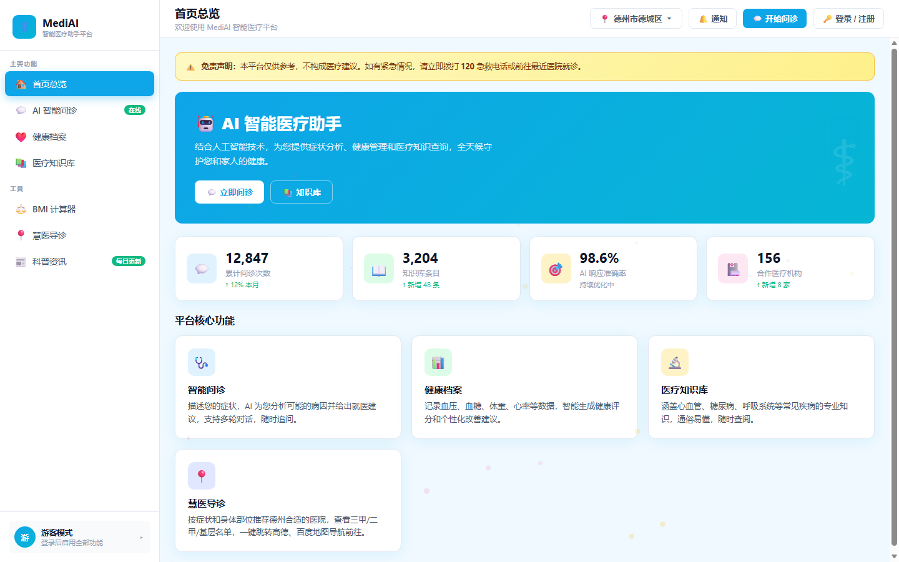
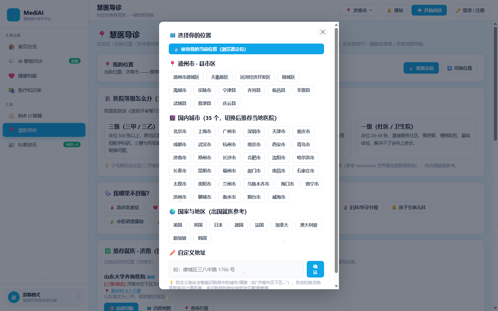
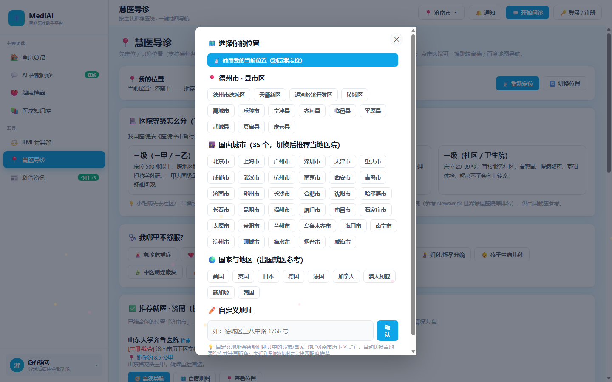

# MediAI 智能医疗助手

> 一个纯前端、零依赖的智能医疗助手平台 —— 无需服务器、无需 API Key，双击 HTML 即可使用，数据全程保存在浏览器本地。
>
> 🌐 在线体验：https://estrella7533.github.io/fengguangyueji_chuanzhibei/

     

---

## 📖 项目介绍

MediAI 是一款面向普通用户（尤其是中老年人群）的智能医疗健康助手。它把「AI 问诊」「健康档案」「医疗知识库」「慧医导诊」「科普资讯」整合在同一个温暖、易用的界面里：

- **能听懂人话的家庭医生**：内置 49 条疾病知识库与多层匹配引擎，能理解"胃疼→一天了→一阵一阵"这样的口语化描述，先共情、再分析，给出可执行的居家处理措施和就医红线信号。
- **会记事的健康管家**：血压、血糖、BMI 一键归档，自动生成健康评分、趋势图和个性化建议，并按时推送复查、打卡等贴心提醒。
- **📍 会带路的导诊助手**：像外卖软件一样定位你的位置、一键切换地址（德州 13 县市区、全国 35 城、9 个国家），切换后自动推荐当地医院，按「症状匹配度 + 距离」排序，支持高德 / 百度一键导航。
- **📰 每天新鲜的科普资讯**：20 篇健康科普每日轮换更新，每篇自动配上当天随机照片，每天打开看到的配图都不一样；内置小日历，可回看近 3 个月任意一天的资讯。
- **跨设备云同步**：手机电脑登录同一账号，健康档案自动保持一致（数据存在你自己的 GitHub 私密 Gist 中）。
- **隐私优先**：账号密码采用 PBKDF2 加盐哈希，明文永不落盘；健康数据默认只保存在你自己的浏览器里。

## 🎯 项目背景与意义

随着我国老龄化进程加快，「看病难、挂号难、不知道去哪家医院」成为许多家庭的实际困扰：

- 老年人对互联网医院、线上挂号等新服务不熟悉，常因"不知道该挂哪个科、去哪家医院"耽误就诊；
- 健康科普信息鱼龙混杂，长辈容易被伪科普误导；
- 慢性病管理依赖家人提醒，缺少便捷的记录与复查提醒工具。

本项目以「零门槛、零安装、数据不出浏览器」为原则，把问诊引导、健康档案、医院导诊和每日科普做进一个纯前端页面，双击即用、手机电脑通用，让健康守护变得像点外卖一样简单。

## ✨ 项目亮点

- **🩺 本地家庭医生引擎**：内置 49 条疾病知识库与智能匹配，能真正"听懂"你的描述（时长、阵发性、疼痛程度、已采取措施等），给出阶段判断、可执行的居家处理措施和就医红线信号，并结合你的健康档案生成个性化提醒 —— 不再是复读反问的"人工智障"。
- **💬 多轮连续对话**：AI 记得你前面说过什么，支持"胃疼→一天了→一阵一阵"这样的连续追问，回复带打字机逐字输出，像真人医生在和你聊天。
- **📍 慧医导诊 · 外卖软件式定位**：顶栏和导诊页都有定位按钮，支持浏览器 GPS 定位、德州 13 县市区、全国 35 城（含全部省会与计划单列市）与 9 个国家快捷切换，以及自定义地址（自动识别其中城市名）；内置 40+ 个城市的医院库（含梅奥诊所、协和、华西等国内外知名医院），位置一换推荐立刻换成当地医院，按「症状匹配度 + 距离加成」综合排序，每张医院卡片显示"距你多远"，并标注 🏆 离你最近的医院。
- **📰 每日科普 · 每天不一样的配图**：20 篇健康科普按日期轮换"今日新增"；每篇文章自动配一张当日随机照片（多级图源自动降级，断网也有日期种子生成的占位图），每天打开都是新配图。
- **🗓️ 往日资讯日历**：科普资讯内置小日历，可一键回看近 3 个月（90 天）内任意一天的"当日新增"内容，当天新增置顶展示，一键回到今天。
- **🌸 温馨动态封面**：暖橙渐变背景、漂浮爱心/药丸/听诊器元素、脉动光晕，配"健康守护伙伴"暖心文案，底部数据带 7 项实时统计（知识条数、今日新增科普等），数字滚动动画，打开即被温柔包裹。
- **❤️ 会说话的健康通知**：登录后自动生成个性化提醒（血压偏高复查、一周未录入数据、BMI 减重建议、每日健康贴士），不再是摆设。
- **📊 健康档案可视化**：血压/血糖/体重记录、BMI 自动计算、健康评分环形图、指标变化趋势折线图。
- **📚 医疗知识库**：12 大类常见疾病（心血管、内分泌、呼吸、消化等），每一条都带病因、表现、居家措施、危险信号。
- **🔐 完整的账号体系**：注册 / 登录 / 找回密码 / 游客模式，密码 PBKDF2 加盐哈希，账号与数据按用户隔离存储。
- **☁️ GitHub 云同步**：账号与健康档案可跨设备同步（私密 Gist，仅上传哈希）。

---

## 🖼️ 界面截图

| 首页总览 | 科普资讯（每日配图） |
|---|---|
|  |  |

| 慧医导诊（定位推荐 · 济南） | 位置选择弹窗（县市区 / 35 城 / 9 国） |
|---|---|
|  |  |

| 科普资讯 · 往日资讯日历（近 3 个月回看） |
|---|
|  |

---

## 🏗️ 技术架构

```
┌─────────────────────────────────────────────────┐
│                    界面层                        │
│  index.html + yue.css：开场封面 / 六大板块 / 弹窗 │
├─────────────────────────────────────────────────┤
│                    逻辑层                        │
│  原生 JavaScript（零框架、零构建）：              │
│  · 账号系统（PBKDF2 加盐哈希 + 会话管理）         │
│  · 本地家庭医生引擎（紧急识别→知识库匹配→         │
│    信息解读→多轮追问→健康档案个性化提醒）         │
│  · 慧医导诊（GPS/手动定位 → 距离计算 →            │
│    匹配度+距离综合排序 → 地图导航）               │
│  · 科普配图（按日期轮换 + 多级图源自动降级）      │
│  · 健康评分 / BMI 分析 / Canvas 图表             │
│  · 云同步（GitHub Gist，先拉后推、按时间戳合并）  │
├─────────────────────────────────────────────────┤
│                    存储层                        │
│  localStorage（账号/健康档案/对话/配置/位置，按   │
│  账号隔离）· sessionStorage（开场页单会话展示）   │
│  可选：GitHub 私密 Gist（云同步，跨设备互通）      │
└─────────────────────────────────────────────────┘
```

### 目录结构

```
fengguangyueji_chuanzhibei/
├── index.html          # 入口页面：全部结构与脚本（含各模块分区注释）
├── yue.css             # 全部样式：主题变量 → 布局 → 组件 → 弹窗 → 开场页 → 响应式
├── docs/
│   └── screenshots/    # 界面截图（首页 / 科普资讯 / 慧医导诊 / 位置选择）
├── README.md           # 项目说明（本文件）
└── .env.example        # 环境变量模板（当前版本无需环境变量，仅供扩展参考）
```

### 数据存储与安全

| 数据 | 存储位置 | 说明 |
|---|---|---|
| 账号（用户名、密码哈希） | localStorage `mediai-users` | PBKDF2 12 万次迭代 + 随机盐，明文不落盘 |
| 健康档案 / 血压趋势 | localStorage `mediai-health-records_<用户>` 等 | 按账号隔离，每日归档一次、不可篡改 |
| 对话记录 | localStorage `mediai-chat-history` | 仅保存最近 20 轮 |
| 我的位置 | localStorage `mediai-guide-loc` | 仅存本机，用于导诊距离计算与推荐排序 |
| 云同步配置（令牌等） | localStorage `mediai-sync-cfg` | 仅本设备浏览器，只用于读写你自己的 Gist |
| 开场页展示标记 | sessionStorage | 每次新会话展示一次 |

### ☁️ 云同步机制

- 数据存放于你的 **GitHub 私密 Gist**（`MediAI云同步空间·<空间名>`），仅你可见。
- 同步策略：**先拉取云端合并到本机，再把合并结果推送**（防止空设备覆盖云端数据）；冲突按 `updatedAt` 时间戳"新者胜"。
- 触发时机：开启云同步后，启动应用、登录、注册、录入健康数据时自动同步。
- 令牌权限最小化：仅需 `gist` 权限；密码只上传哈希，健康数据仅存于你的 Gist。

---

## 🧭 功能导览

| 模块 | 路径 | 说明 |
|---|---|---|
| 首页总览 | 侧边栏「首页总览」 | 免责声明、动态 Hero、数据统计、核心功能卡片 |
| AI 智能问诊 | 侧边栏「AI 智能问诊」 | 多轮对话，支持症状关键词、时长/阵发性解读、追问 |
| 健康档案 | 侧边栏「健康档案」 | 录入血压血糖体重、健康评分、趋势图 |
| 医疗知识库 | 侧边栏「医疗知识库」 | 12 大类疾病科普，可按分类筛选、关键词搜索 |
| BMI 计算器 | 侧边栏「BMI 计算器」 | 输入身高体重即时计算 BMI 与体型分类 |
| 慧医导诊 | 侧边栏「慧医导诊」 | 定位/切换位置 → 按症状推荐当地医院（越近越优先）→ 一键地图导航 |
| 科普资讯 | 侧边栏「科普资讯」 | 每日更新的健康科普文章，每篇自动配当日随机照片 |
| 往日资讯日历 | 科普资讯页「📅 往日资讯日历」 | 回看近 3 个月任意一天的当日新增资讯 |
| 定位服务 | 顶栏「📍 当前位置 ▾」 | 浏览器 GPS 定位 / 德州县市区 / 全国 35 城 / 9 国 / 自定义地址 |
| 消息中心 | 顶栏「🔔 通知」 | 打卡/复查/科普更新/每日贴士等个性化提醒 |
| 云同步 | 左下角用户卡 →「☁️ 云同步」 | 跨设备账号与健康档案互通 |

## 📱 使用说明

1. **进入平台**：打开页面 → 开场页点击「🚪 进入 MediAI 医疗空间」；首次使用可点「游客模式」免注册体验。
2. **问诊**：点击「💬 AI 智能问诊」，用大白话描述症状（如"胃疼，一天了，一阵一阵"），AI 会先共情、再分析，并给出居家措施与就医红线信号。
3. **找医院**：点击「📍 慧医导诊」→ 点顶栏或导诊页的定位按钮选择你的位置（支持 GPS 定位 / 德州县市区 / 全国 35 城 / 9 个国家 / 自定义地址）→ 点一个症状，系统切换为当地医院库，按「匹配度 + 距离」推荐医院，每张卡片显示"距你多远"；位置变了推荐自动重排。
4. **看科普**：点击「📰 科普资讯」，带"今日新增"徽章的是当天新内容；每篇都有当天随机配图，点卡片阅读全文。想看往期内容，点「📅 往日资讯日历」选择近 3 个月内任意日期即可。
5. **记健康**：登录后进入「❤️ 健康档案」录入血压 / 血糖 / 体重，自动生成健康评分、趋势图与个性化建议。
6. **收提醒**：顶栏「🔔 通知」会按时推送打卡、复查、科普更新等个性化提醒。

---

## 🚀 安装运行指南

### 环境要求

- 任意现代浏览器（Chrome / Edge / Safari / Firefox 最新版），手机浏览器同样支持；
- **无需** Node.js、无需构建工具、无需任何运行时环境。
- 浏览器定位功能需要 HTTPS 或 localhost 环境（在线版直接支持）。

### 方式一：在线访问（推荐）

直接打开：**https://estrella7533.github.io/fengguangyueji_chuanzhibei/**

托管于 GitHub Pages，推送后自动部署，手机电脑通用。

### 方式二：直接打开文件

双击 `index.html` 即可在浏览器中运行，无需任何安装。

### 方式三：本地静态服务器（可选）

```bash
# 任选其一
python3 -m http.server 8080
# 或
npx serve .
```

然后访问 `http://localhost:8080/`

---

## ⚙️ 环境配置说明

### 环境变量

**当前版本为纯静态站点，开箱即用，不需要任何环境变量、API Key 或密钥。**

- 云同步所需的 GitHub 令牌**不通过环境变量配置**：登录后打开「左下角用户卡 → ☁️ 云同步」，在界面内粘贴并保存（仅存于本设备浏览器 localStorage）。
- 科普资讯配图为联网加载（无需任何密钥），网络不可用时自动降级为本地生成的日期占位图。
- 未来若接入后端服务，可参考仓库根目录的 `.env.example` 模板（见下）。

### 环境变量模板

见仓库文件 `.env.example`：

```bash
# MediAI 环境变量模板
# 当前版本（纯前端静态应用）无需任何环境变量，此模板仅供未来扩展参考。
# 云同步令牌在网页内配置：登录 → 左下角用户卡 → ☁️ 云同步 → 粘贴令牌
```

## 📦 依赖清单

| 类别 | 依赖 | 版本要求 |
|---|---|---|
| 运行时依赖 | **无**（零外部依赖） | — |
| 构建/打包 | **无**（零构建，直接打开即用） | — |
| 浏览器 API | localStorage / sessionStorage / Web Crypto (PBKDF2) / Canvas 2D / Geolocation（定位）/ fetch（云同步时） | 现代浏览器内置 |
| 图片 | 科普配图来自 Unsplash / Bing 等免费图源（联网），离线自动降级为本地 SVG 占位图 | — |
| 图标 | Emoji（系统自带） | — |
| 字体 | 系统默认字体栈 | — |

> 云同步为可选功能，仅在用户主动配置令牌后才发起网络请求（目标：api.github.com）。

---

## 🩺 AI 问诊是怎么"变聪明"的？

这是本项目最核心的部分。

**以前的痛点**：用户说"胃疼"，AI 答完；用户再补充"一天了""一阵一阵"，AI 却照旧甩出四个反问 —— 完全没消化用户的话，体验像"人工智障"。

**现在的做法**：内置一套 `本地家庭医生引擎`，由多层组成 ——

1. **紧急症状优先**：胸痛、呼吸困难、意识模糊、大出血等关键词命中即先提醒拨打 120，不废话。
2. **疾病知识库匹配**：49 条疾病条目，按标题、别名、标签、症状描述打分匹配，命中即输出"常见表现 + 居家措施 + 危险信号"。
3. **🆕 信息解读引擎**：用户补充"一天了""一阵一阵""很疼""睡不着""以前没有"这类描述时，AI 会：
   - 把用户说过的话**复述回去**（"我记着你刚才说的「胃疼」，现在你又说「一天了」"）
   - 解读**时长**：不到一天 → 观察为主；超几天 → 别硬扛；拖几周 → 尽快就医
   - 解读**规律**：阵发性 → 多为功能性、可对症缓解；持续不断 → 需找根源
   - 解读**疼痛程度、是否影响睡眠、是否已采取措施**等
   - 给出**现在就能做的三件事**和**就医红线信号**
4. **健康档案个性化提醒**：回答末尾结合你最近一次健康档案（血压/血糖/BMI/评分异常时）附加专属提醒。
5. **多轮追问**：围绕同一话题深入补充，或切换到新症状。

> 💡 本引擎纯本地运行，**无需任何 API Key**——打开页面就能用，所有回答都来自内置知识库与规则引擎，数据不出浏览器。

---

## 📍 慧医导诊与定位服务是怎么工作的？

参考外卖软件的定位体验设计：

1. **定位方式四选一**：点顶栏「📍 当前位置 ▾」或导诊页「切换位置」：
   - 📡 **浏览器 GPS 定位**：自动获取经纬度，并匹配最近的县市区/城市显示（如"济南市（附近）"）；
   - 📍 **德州县市区**：13 个县市区一键切换；
   - 🌆 **国内城市**：全国 35 城（直辖市、全部省会、计划单列市及德州周边城市）；
   - 🌍 **国家与地区**：美国、英国、日本、德国、法国、加拿大、澳大利亚、新加坡、韩国（出国就医参考）；
   - ✏️ **自定义地址**：手输任意地址，自动识别其中的城市/国家名并切换对应医院库。
2. **城市医院库**：内置 40+ 个城市的医院数据（共 100+ 家），覆盖协和、华西、齐鲁等国内知名三甲与梅奥诊所、麻省总医院等国际顶级医院；位置一切换，推荐立刻换成当地医院。
3. **距离计算**：内置球面距离公式（Haversine），为每所医院实时计算"距你多远"，单位自动切换（米 / 公里 / 千公里）。
4. **综合排序**：推荐分 = 症状匹配分 + 距离加成（≤2km 加 30 分，≤5km 加 25 分……逐级递减），位置一变，推荐立刻重排。
5. **体验细节**：每张医院卡片显示距离，推荐列表标注 🏆 离你最近的医院；异地/跨国就医有"请提前预约确认"提示；「高德导航」自动带上你的起点位置，点开就是"从你这里出发"的路线。
6. **隐私**：位置只存在本机浏览器 localStorage，不上传任何服务器。

---

## 📰 每日科普配图是怎么做到"每天都不一样"的？

- **内容每日轮换**：20 篇科普文章按日期做种子选出当天 3 篇「今日新增」，当天不变、次日换新。
- **配图每日变化**：每篇文章的封面图按「日期 + 文章序号」做种子从免费图源轮换，同一天内稳定、第二天整体换一批，永不重样。
- **多级图源自动降级**：Unsplash 免费图库 → 国内可访问的每日壁纸接口 → Bing 每日壁纸备用池 → 离线 SVG 占位图（配色图案同样由日期种子生成，每天不一样），任何网络环境下卡片都不留破图。
- **图片标注**：每张封面右下角带「📷 每日配图 · 日期」角标，一眼看出是当天的新鲜配图。

## 🗓️ 往日资讯日历是怎么回看历史的？

- **近 3 个月回看**：日历可查询今天往前 90 天内的任意日期，更早日期与未来日期置灰不可选。
- **与今日同一套算法**：任意日期的「当日新增 3 篇」都用同一日期种子算法生成，与当天真实展示的内容完全一致，保证回看数据真实可复现。
- **小日历交互**：月份左右翻页、今天有圆框标注、已选日期实心高亮；选中后当天新增置顶展示并带「当日新增」徽章，一键「↩️ 回到今天」恢复实时内容。

---

## 🎨 封面与视觉

- **配色**：暖橙 + 蜜桃 + 樱花粉 + 薄荷绿，告别冰冷科技蓝
- **动态元素**：背景漂浮爱心、药丸、听诊器、草药杯、咖啡杯；光晕缓慢脉动；打字机文字循环切换"准备健康空间 / 加载知识库 / 校准评分模型"等
- **进入按钮**：品牌蓝渐变胶囊按钮，带呼吸光圈与脉动光晕，文案为「🚪 进入 MediAI 医疗空间 →」
- **底部数据带**：7 项平台实力实时统计（医疗知识条数、科普资讯篇数、疾病分类数、居家措施条数、核心功能数、今日新增科普、数据本地保存），数字动态滚动，与站内真实数据一致

---

## 🔔 通知中心是做什么的？

很多用户第一次看到「通知」会疑惑"我都登录了，通知有什么用"。其实它的定位是 **你的健康生活小秘书**，而不是聊天消息。

登录后打开通知中心，会自动收到以下个性化提醒：

| 类型 | 触发场景 | 示例 |
|---|---|---|
| 📋 症状提醒 | 根据你说过的身体状况 | "你上次提到胃部不适，持续两天以上建议就医" |
| 💉 复查提醒 | 血压偏高、血糖异常 | "近期血压偏高，建议近期复查并控制盐摄入" |
| 📅 系统公告 | 平台更新、科普推荐 | "今日新增 3 篇秋冬养生科普" |
| ⏰ 定时问候 | 早/午/晚按时段 | "早上好，记得吃早餐再出门哦" |

**核心用法**：配合 AI 问诊使用 —— 问诊后 AI 会建议"三天后还没好转就来找我"，届时通知中心会帮你把这条记下来。

---

## 👥 团队信息

| 角色 | 姓名 |
|---|---|
| 队名 | **风光霁月** |
| 指导老师 | 刘微 |
| 队长 | 郝梓萱 |
| 队员 | 王苗苗、李欣彤 |

### 团队分工

| 成员 | 负责模块 |
|---|---|
| 郝梓萱（队长） | 整体架构设计、AI 智能问诊引擎、健康档案与云同步 |
| 王苗苗 | 慧医导诊与定位服务、医疗知识库 |
| 李欣彤 | 科普资讯与每日配图、界面视觉与开场封面 |

> 以上分工为建议口径，提交前请按实际情况调整。

---

## 📄 开源协议

本项目采用 [MIT 开源协议](https://opensource.org/licenses/MIT)，可自由学习、使用与二次开发，使用时请保留原作者署名。

---

## ⚠️ 免责声明

**本平台仅供参考，不构成医疗建议。** AI 给出的分析基于内置知识库与规则匹配，不能替代专业医生的面诊与诊断。如有紧急情况，请立即拨打 **120** 急救电话或前往最近医院就诊

---

## 📝 更新日志

### v1.6
- 🌍 **定位服务大升级**：位置选择从 4 城扩展到德州 13 县市区 + 全国 35 城（直辖市、全部省会、计划单列市及周边城市）+ 9 个国家/地区；内置 40+ 城市共 100+ 家医院库（协和、华西、齐鲁等国内知名三甲与梅奥诊所、麻省总医院等国际顶级医院），位置一换推荐立刻换成当地医院；自定义地址自动识别城市/国家名；异地/跨国就医显示"请提前预约确认"提示
- 🗓️ **科普资讯新增往日日历**：可回看近 3 个月（90 天）内任意一天的当日新增资讯，当天内容置顶展示，一键回到今天
- 📖 **README 同步更新**：功能说明、使用说明、界面截图与更新日志

### v1.5
- 📍 **新增定位服务**：顶栏与慧医导诊页新增「定位 / 切换位置」功能键（外卖软件式交互），支持浏览器 GPS 定位、德州 13 县市区与周边城市快捷切换、自定义地址；医院推荐按「症状匹配度 + 距离加成」综合排序，位置改变推荐自动重排，卡片显示"距你多远"并标注 🏆 最近医院，高德导航自动带上起点位置
- 📰 **科普资讯新增每日配图**：每篇文章自动配当日随机照片（按日期轮换，每天都不一样），多级图源自动降级，断网也有日期种子生成的占位图
- 📖 **README 重构**：按大赛提交规范补充项目背景与意义、界面截图、使用说明、团队分工与开源协议

### v1.4
- ☁️ **新增 GitHub 云同步**：账号与健康档案跨设备互通（私密 Gist、先拉后推、时间戳合并）
- 📊 **封面数据带改为实时统计**：7 项数据全部来自站内真实数据，修复"居家处理措施显示 0"统计路径错误
- 📖 **README 重构**：补充技术架构、环境配置说明、依赖清单与团队信息
- ✨ **代码注释完善**：入口文件与样式表增加结构说明注释

### v1.3
- 🐛 **修复左下角用户卡点击无效**：游客点击直达登录，登录后点击展开账号菜单（消息中心 / 云同步 / 退出登录）
- 🩺 **AI 问诊引擎再升级**：回答结合你的健康档案（血压/血糖/BMI/评分异常时自动附加个性化提醒）；补充症状描述时结合之前提到的病症给出针对性危险信号提醒；新增"胃疼/反酸/烧心/嗓子疼"等口语别名

### v1.2
- 🩺 **AI 问诊升级**：新增信息解读引擎，能真正消化用户补充的时长、阵发性、疼痛程度、已采取措施等信息，告别复读反问
- 🌸 **封面翻新**：暖橙配色、温馨文案、动态漂浮元素
- 📊 **数据带扩容**：底部统计扩展并动态滚动
- 🔔 **通知中心**：明确健康提醒定位，支持个性化提醒生成
- 🐛 **修复**：中文数字（一天/两天/半个月）时长解析、追问分支判定时机

### v1.1
- 新增健康档案可视化（环形评分、趋势折线图）
- 新增科普资讯模块
- 完善账号体系（注册 / 登录 / 找回密码）

### v1.0
- 初始版本：封面、登录注册、AI 问诊、知识库、BMI 计算器
